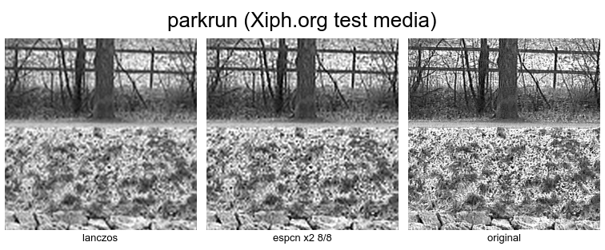
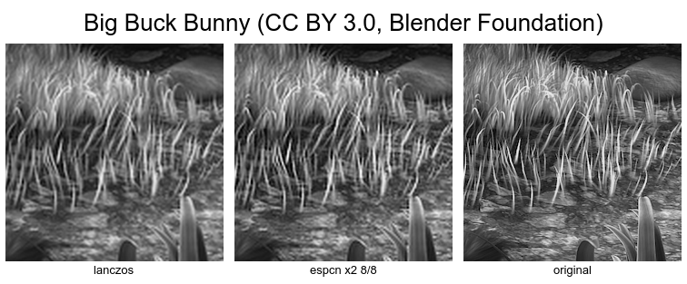

# espcn-mpv

Train a small [ESPCN](https://arxiv.org/abs/1609.05158) super-resolution
network on images you pick, then compile the trained weights into an
[mpv](https://mpv.io/) custom shader that upscales video luma in real time.

Same idea as [haasn/fsrcnn-mpv](https://github.com/haasn/fsrcnn-mpv) but for
ESPCN, and with no pretrained weights shipped. The point is to train on
content that looks like what you actually watch (live action, anime, one
specific show) and get a shader tuned for it.

```
  images ──▶ train ──▶ checkpoint (.pt) ──▶ export ──▶ weights (.npz)
                                                            │
                                                            ▼
                                                         gen-glsl
                                                            │
                                                            ▼
                                              shader (.glsl) ──▶ mpv
```

The network runs on the luma (Y) channel only: two convolutions (5x5 then
3x3) with ReLU, a third 3x3 convolution producing `scale * scale` channels,
and a sub-pixel shuffle that turns those channels into the upscaled image.

`shaders/espcn_x2_8.glsl` is a generated example so you can see the output
format without training anything first.





640x360 upscaled 2x to 1280x720, shown at 100%. These are luma only, which is
all the shader touches. The crops are the regions where the two upscalers
disagree most, picked by search rather than by eye. Numbers are in section 5.

## 1. Getting a training set

No training images ship with this repo. They aren't mine to redistribute, so
you supply your own. Everything under `data/` is gitignored.

The usual starting point is **DIV2K**:
<https://data.vision.ee.ethz.ch/cvl/DIV2K/>. Download `DIV2K_train_HR.zip`
(800 high-resolution photos) and unzip it to `data/DIV2K_train_HR/`. That is
enough to train a decent general-purpose upscaler. Hold a few images out into
a second folder to use as `--val-dir` if you want a PSNR number each epoch.

Because the model is tiny, it pays to train separate weights per kind of
content rather than one shader for everything. Put each kind in its own folder
and train once per folder:

```
data/
  live_action/
  animation/
```

To build those from your own video files, pull frames out with ffmpeg. Sample
every N frames rather than every frame, since consecutive frames are nearly
identical and just make an epoch slower without adding information:

```bash
# one frame every 120 (~ every 5s at 24fps), as high-quality PNGs
ffmpeg -i show.mkv -vf "select=not(mod(n\,120))" -fps_mode vfr data/animation/show_%05d.png
```

Use sources that are actually sharp. The training pairs are made by
downscaling your images, so if the source is soft or full of compression
artifacts the model learns to reproduce softness.

## 2. Install

```bash
uv sync
```

This pulls `torch` and `torchvision` from the CUDA 12.6 wheel index and
everything else from PyPI. Training on CPU works but is slow. Pass
`--device cpu` if you have no GPU.

## 3. Train, export, generate

```bash
# train (scale 2, 8+8 channels, 100 epochs)
uv run espcn-mpv train \
  --data-dir data/DIV2K_train_HR \
  --val-dir data/val \
  --scale 2 --d1 8 --d2 8 \
  --patch-size 96 --patches-per-image 20 \
  --batch-size 64 --epochs 100 --lr 1e-3 \
  --checkpoint-dir checkpoints --checkpoint-name espcn_x2_8

# export the final checkpoint to a flat .npz
uv run espcn-mpv export \
  --checkpoint checkpoints/espcn_x2_8_final.pt \
  --out weights/espcn_x2_8.npz

# compile the weights into an mpv shader
uv run espcn-mpv gen-glsl \
  --weights weights/espcn_x2_8.npz \
  --out shaders/espcn_x2_8.glsl \
  --name espcn_x2_8
```

Every epoch writes `checkpoints/<name>_epoch<N>.pt` (model plus optimizer, so
you can `--resume` from one). The run ends by writing a stable
`checkpoints/<name>_final.pt`, which is the file `export` expects by
convention.

### What a healthy run looks like

Loss should start around **0.2** and drop under **0.01** within the first
epoch or two. If it starts in the *single digits* instead, the output layer is
initialized too large and most of the hidden channels will die to the ReLU
within a few hundred steps. See the comment in `model.py`.

Measured on DIV2K x2, the model passes bicubic at roughly 4000 steps and
plateaus about **+1.3 dB over bicubic** around 20000 steps (~80 epochs at the
default settings). That is what a 400-parameter network has to give.

### Degradation training (`--degrade`, on by default)

Training only on bicubic-downscaled pairs teaches the model to invert bicubic
specifically. It scores well when the test input was made the same way, and
loses that edge on anything else, which is every real video. So the LR side of
each pair gets a randomized trip through what actually happens to video:
optional slight blur, a downscale kernel drawn from bicubic/bilinear/box/
lanczos, JPEG at quality 55-95 half the time, and occasional mild noise. The
HR target is always left clean.

Measured on 40 held-out DIV2K images, `--d1 8 --d2 8`, versus lanczos:

| LR produced by | plain | **with `--degrade`** |
|---|---|---|
| bicubic (matches training) | +0.78 dB | +0.66 dB |
| lanczos downscale | +0.30 dB | +0.32 dB |
| box/area downscale | -0.12 dB | **+0.27 dB** |
| bicubic + JPEG q85 | -0.04 dB | **+0.12 dB** |

Degradation costs 0.12 dB in the bicubic case, which never happens with real
video, and turns both losses into wins. Use `--no-degrade` only to reproduce a
clean-pair baseline. Validation PSNR is always computed on clean bicubic pairs
so the number stays comparable between runs.

### Picking `--d1` and `--d2`

Any width works, since the generator splits wide layers across several
textures (see section 6). Wider is not worth much, though. Measured on DIV2K
x2, 12000 steps each:

| d1 / d2 | params | passes | PSNR vs bicubic |
|---|---|---|---|
| 4 / 4 | 400 | 3 | +1.19 dB |
| **8 / 8** | 1084 | 5 | **+1.38 dB** |
| 16 / 16 | 3316 | 9 | +1.38 dB |
| 32 / 16 | 6036 | 13 | +1.46 dB |

The gains stop almost immediately. `8 / 8` captures most of it and everything
past that buys hundredths of a dB for more passes per frame. The ceiling is
ESPCN's depth (three layers over a 9x9 receptive field), not its width, so
spending on channels does not move it. Use `--d1 8 --d2 8`.

## 4. Using the shader in mpv

```bash
mpv --glsl-shaders=shaders/espcn_x2_8.glsl video.mkv
```

Or make it permanent in `mpv.conf`:

```
glsl-shaders="~~/shaders/espcn_x2_8.glsl"
```

`~~/` is mpv's own config directory, so `~/.config/mpv/` on Linux and
`%APPDATA%\mpv\` on Windows. An absolute path works too. If you run a portable
mpv build, `~~/` points at `portable_config/` next to the executable instead.
To stack several shaders, separate them with `:` on Unix or `;` on Windows.

The shader hooks `LUMA`, so chroma is left to mpv's normal scaler. A `scale 2`
shader upscales the luma plane 2x regardless of your window size, and mpv then
scales that result to fit as usual.

Every pass carries a `//!WHEN` guard copied from FSRCNNX, so the shader costs
nothing unless the output is at least 1.3x the source resolution. You can
leave it in `mpv.conf` permanently without it firing on content that is
already big enough. The flip side is that a small window silently disables it:
if you are testing and nothing seems to happen, check your output resolution
first.

**Use a float framebuffer.** The intermediate feature maps are unbounded ReLU
outputs and will exceed 1.0. An 8-bit FBO clamps them and the picture comes
out wrong. `vo=gpu-next` already picks a float format, but on older `vo=gpu`
add:

```
fbo-format=rgba16f
```

FSRCNNX documents the same requirement for the same reason.

## 5. Verifying the shader

The shader is meant to be the PyTorch model compiled to GLSL. Two things can
go wrong independently: the generator can emit arithmetic that does not match
the model, or the arithmetic can match and the model still not be worth
running. There is a subcommand for each half.

```bash
# score a checkpoint over frames sampled from clips
uv run espcn-mpv bench --checkpoint checkpoints/espcn_x2_8_final.pt \
  --frames 12 eval/*.y4m eval/*.mkv

# run a checkpoint on one image, which is what the shader should reproduce
uv run espcn-mpv infer --checkpoint checkpoints/espcn_x2_8_final.pt \
  --input eval/lr_gray.png --out eval/model_gray.png

# score images or whole frame directories against a reference, on luma
uv run espcn-mpv compare --reference eval/hr_gray.png --crop 8 \
  eval/shader_gray.png eval/scaler_gray.png
```

Capturing the shader's output from mpv has a few traps in it. `eval/README.md`
covers them.

### Does it beat the filters it replaces

12 frames from each of four clips: Xiph `flower_garden`, `parkrun` and
`shields`, plus a segment of Big Buck Bunny. Each frame is downscaled 2x with
lanczos in gamma light and upscaled back, then scored on luma against the
original. Two frames are dropped as flat, leaving 46.

| upscaler | MAE | PSNR | SSIM | MS-SSIM |
|---|---|---|---|---|
| **espcn x2 8/8** | **0.02557** | **28.35 dB** | **0.8978** | **0.99088** |
| lanczos | 0.02617 | 27.99 dB | 0.8842 | 0.98907 |
| bicubic | 0.02748 | 27.48 dB | 0.8718 | 0.98777 |

It wins every metric on every clip, by +0.36 dB over lanczos and +0.87 dB over
bicubic. The margin is widest on `parkrun`, the densest and highest frequency
clip of the four, and narrowest on `flower_garden`.

`bench` drops frames whose detail falls far below the clip's median. Both
`parkrun` and `shields` open on a flat grey leader, and a frame like that is
trivial for any upscaler, so leaving it in pulls every method toward the same
score and hides the differences the benchmark exists to find.

Note the shape of the win. PSNR moves by about 1%, SSIM by 1.5%, MS-SSIM by
less in absolute terms but from a much higher floor. PSNR rewards the
conservative, slightly soft answer, so a model that adds detail tends to show
a smaller PSNR margin than its perceptual one. Reporting only PSNR would
undersell this, and reporting only SSIM would oversell it.

The +0.35 dB over lanczos lines up with the +0.32 dB the `--degrade` table in
section 3 predicts for lanczos-downscaled input, which is a useful consistency
check between two independently measured things.

### Is the shader oriented correctly

If mpv's texture y axis ran opposite to PyTorch's row order, the network would
run with a vertically mirrored kernel, and flipping the y offsets in
`gen_conv2_passes` and `gen_final_pass` would *improve* the output. On one
`flower_garden` frame, captured out of mpv:

| shader | PSNR | SSIM |
|---|---|---|
| as generated | 27.96 dB | 0.9417 |
| y offsets flipped | 20.56 dB | 0.8055 |

Flipping costs 7 dB, so the texture-space derivation in `gen_final_pass`
already agrees with PyTorch's row order.

### Does it match the model

Same input through both, scoring the shader's output against the model's:

| | PSNR | SSIM |
|---|---|---|
| shader vs model, interior | 54.3 dB | 0.99895 |
| capture path noise floor | 58.7 dB | 0.99960 |

The noise floor is what an unmodified frame scores after a round trip through
mpv and a screenshot, so it is the ceiling any measurement taken this way can
reach. 54.3 dB against a 58.7 dB ceiling leaves float precision in GLSL and
8-bit output quantization, not a codegen bug.

`--crop 8` matters here. torch's `Conv2d` pads with zeros while a texture
sampler clamps to the edge, so the outer pixels disagree by construction and
say nothing about the interior. Scoring the whole frame gives 50.2 dB instead
of 54.3 dB.

### Still open

All four clips are photographic or 3D rendered. None of them is hand-drawn
2D animation, which is a different regime: flat color regions bounded by hard
ink lines, rather than continuous texture. A shader for that content wants its
own training run on that content, and its own numbers.

`bench` scores the PyTorch model rather than the compiled shader, because
driving mpv once per frame is slow. That is only reasonable because the two
were shown to agree above, and it is worth re-checking after any change to
the generator.

Training and playback do not use quite the same definition of luma. Pillow's
`convert("YCbCr")`, which `dataset.py` uses to build pairs, is BT.601
full-range, while mpv hands the shader BT.709 luma for HD content. Measured on
a real 720p frame the two are 57 dB apart, mean 0.28/255 and max 1.58/255, so
it is well below the margins above and has not been worth restructuring the
pipeline over. It may matter more on saturated palettes, where the BT.601 and
BT.709 coefficients diverge most.

With `--degrade` the model sees mild JPEG and noise during training, so it
tolerates ordinary compressed sources, but it is an upscaler and not a
restoration model. Heavy banding, ringing or block artifacts are not what it
was trained to remove.

## 6. How the shader is laid out

A `//!SAVE` texture has four components, so a layer carries at most 4 feature
channels per texture. Wider layers are split across several: `--d1 16` emits
four passes saving `conv1_1 .. conv1_4`, and the conv2 passes bind all four to
reassemble the 16-channel activation. This is the scheme FSRCNNX uses to carry
8 or 16 feature maps, and it is why there is no cap on `--d1` and `--d2`.

The pass count is `ceil(d1/4) + ceil(d2/4) + 1`. Everything except the last
pass runs at *source* resolution. The upscale happens only in the final pass,
where conv3 and the pixel shuffle are fused. That is the core ESPCN idea, and
the reason it is cheap enough to be a shader at all: a network that upscaled
first and then convolved would do `scale^2` times the work.

Reference implementations worth reading next to `gen_glsl.py`:

- [igv/FSRCNN-TensorFlow](https://github.com/igv/FSRCNN-TensorFlow) is the
  source of the FSRCNNX shaders. The multi-texture packing and the aggregation
  pass this generator's final pass is modeled on both come from there.
- [bjin/mpv-prescalers](https://github.com/bjin/mpv-prescalers) has RAVU and
  nnedi3 as generated GLSL. RAVU is a learned *filter bank* (RAISR-style
  gradient hashing) rather than a CNN, and stores its weights in a lookup
  texture instead of as literals.
- [bloc97/Anime4K](https://github.com/bloc97/Anime4K) exports CNN modes the
  same way, tuned for animation.

Two of their optimizations are deliberately not implemented here: bilinear tap
merging (placing a sample between two texels so the texture unit returns a
weighted sum of both, halving fetches) and compute-shader passes. Both would
need real GPU testing to validate, and neither reference uses bilinear merging
for its convolution taps.

## Repository layout

```
src/espcn_mpv/    model, dataset, training, export, GLSL generator, metrics
tests/            unit tests, run with `uv run pytest`
shaders/          generated .glsl (one example committed, rest gitignored)
eval/             scratch space for validating a shader, see eval/README.md
docs/images/      before/after crops used in this README
data/             training sets, gitignored
checkpoints/      training output, gitignored
weights/          exported .npz, gitignored
```

## Development

```bash
uv sync --group dev
uv run pytest
```

The tests cover the parts where a mistake is silent rather than loud. A
transposed convolution kernel or an off-by-one in the channel packing still
produces a shader that compiles and runs, so `tests/test_gen_glsl.py` parses
the emitted weight literals back out and checks them against the weights that
went in. The metric tests pin down the properties the hand-rolled PSNR, SSIM
and MS-SSIM implementations are supposed to have.

## License

MIT, see [LICENSE](LICENSE).

Test media in the comparison images is not mine: Big Buck Bunny is CC BY 3.0
by the Blender Foundation, and `parkrun` comes from the Xiph.org test media
collection. No training data ships with this repository.
